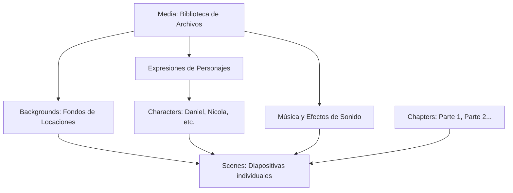

# Guía del Creador: Cómo usar el Panel de Administración (CMS)

¡Bienvenida a la plataforma de gestión de **El Mundo de Armonía**! Esta guía explica cómo está organizado el panel y el paso a paso para crear, subir y conectar tus escenas interactivas.

---

## ¿Qué es cada Colección en el menú lateral?

El panel organiza los elementos de la historia de forma modular. Esto te permite **reutilizar dibujos** (como fondos o expresiones de personajes) sin tener que subirlos una y otra vez en cada diapositiva.

---

### 1. `Users` (Usuarios Administradores)

* Son las personas que tienen acceso a este panel para editar la novela.
* Aquí puedes cambiar tu contraseña, tu correo o añadir colaboradores con acceso.

---

### 2. `Backgrounds` (Galería de Fondos y Locaciones)

* Cada lugar o escenario del mundo (ejemplo: *Habitación de Daniel*, *Subte Estación*, *Refugia*).
* Cuando creas una escena en `Scenes`, el selector de fondo te muestra directamente esta lista limpia de locaciones sin mezclarte sprites ni botones.

---

### 3. `Characters` (Biblioteca de Personajes)

Un personaje no es solo una imagen: es una figura que tiene nombre, color propio y una variedad de estados de ánimo.

* Al crear un personaje defines:
  * **Nombre:** (Ej: `Daniel Torres`).
  * **Color característico:** (Para la etiqueta que aparece sobre su diálogo).
  * **Biblioteca de Expresiones:** Puedes cargar todas sus expresiones vinculándolas desde `Media`. El sistema **autofiltra automáticamente** para que solo elijas sprites de personajes sin confundirte con fondos:
    * *Dormido* -> Sprite de Daniel con ojos cerrados.
    * *Sonriendo* -> Sprite de Daniel feliz.
    * *Sorprendido* -> Sprite de Daniel en shock.

---

### 4. `Media` (Biblioteca Central de Archivos)

Es el almacén general donde se guardan tus archivos originales en la nube:

* Ilustraciones completas, fondos originales, retratos con fondo transparente y pistas de música/sonido.
* **Ventaja clave:** Subes un archivo una sola vez y lo puedes reutilizar en múltiples personajes, fondos o escenas. Si lo reemplazas en `Media`, se actualizará en todos lados automáticamente.

---

### 4. `Chapters` (Capítulos o Partes)

Organiza los grandes bloques narrativos de la historia:

* **Parte 1:** *La despedida*
* **Parte 2:** *El sendero hacia el castillo*
* Permite ordenar las escenas y mostrarle al lector en qué parte de la aventura se encuentra.

---

### 5. `Scenes` (Los Slides / Diapositivas)

**Cada entrada en `Scenes` representa una diapositiva individual del juego.** Aquí se ensambla todo:

1. **Identificador (`sceneKey`):** Un nombre corto y único para reconocer la escena (ej: `hab_daniel_01`, `hab_daniel_eleccion`).
2. **Capítulo:** A qué capítulo pertenece (ej: *Parte 1: La despedida*).
3. **Formato visual:**
   * **Modo Diapositiva Completa (`flat`):** Si ya tienes la imagen completa dibujada con el texto pegado (como las diapositivas actuales de Drive), simplemente seleccionas esa imagen.
   * **Modo Multicapa (`layered`):** Eliges un fondo de `Media`, agregas al personaje a la derecha o al centro con su expresión (`dormido`), y escribes el diálogo dinámico.
4. **Diálogo:**
   * Nombre del personaje que habla (ej: `DANIEL TORRES`).
   * Acotación o estado entre paréntesis (ej: `(Todavía medio dormido)`).
   * Texto que se escribirá en pantalla con efecto máquina de escribir.
5. **Navegación y Decisiones:**
   * **Lineal:** Avanza a la siguiente escena al hacer clic. Defines qué escena sigue (`nextSceneKey`).
   * **Toma de decisiones (Bifurcación):** Permite agregar botones con opciones para el lector. Cada opción tiene un texto (ej: *«Tocar la guitarra»*) y apunta al identificador de la escena a la que debe saltar.

---

## 🚀 Flujo de Trabajo Recomendado

1. **Paso 1:** Sube tus ilustraciones y dibujos a **`Media`**.
2. **Paso 2:** Si aparece un nuevo personaje, créalo en **`Characters`** y añade sus expresiones con fondo transparente.
3. **Paso 3:** Ve a **`Scenes`** y crea cada diapositiva en orden, conectando la siguiente escena o creando las opciones de ramificación.
